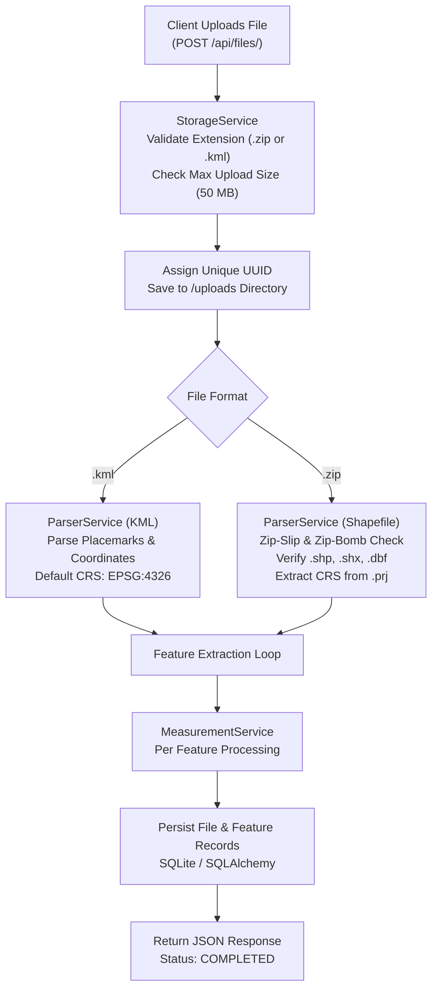
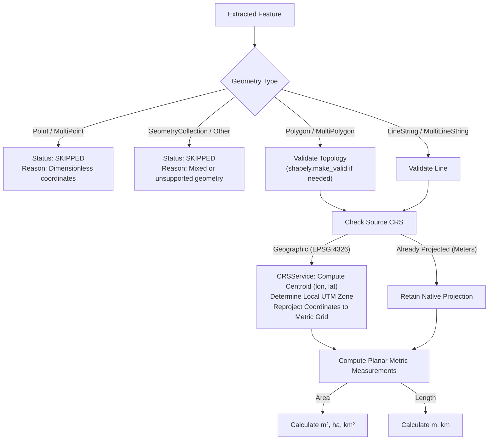

# Geospatial File Measurement API

A production-grade backend service built with **FastAPI** that ingests geospatial files (**Shapefiles** and **KML**), parses features, resolves Coordinate Reference Systems (CRS), and computes high-precision metric measurements (area and length).

[](https://fastapi.tiangolo.com)
[](https://www.python.org/downloads/)
[](https://opensource.org/licenses/MIT)
[](https://docs.pytest.org/)

---

## Table of Contents
1. [Overview & Problem Statement](#overview--problem-statement)
2. [Key Capabilities](#key-capabilities)
3. [Architecture & System Flow](#architecture--system-flow)
   - [Application Structure](#application-structure)
   - [File Processing Flow](#file-processing-flow)
   - [Measurement Calculation Flow](#measurement-calculation-flow)
   - [CRS Handling & Projection Strategy](#crs-handling--projection-strategy)
4. [API Reference & Examples](#api-reference--examples)
5. [Setup & Running Locally](#setup--running-locally)
   - [Option A: Python Virtual Environment](#option-a-python-virtual-environment)
   - [Option B: Docker & Docker Compose](#option-b-docker--docker-compose)
6. [Running Automated Tests](#running-automated-tests)
7. [Design Decisions & Alternatives Considered](#design-decisions--alternatives-considered)
8. [Learnings & Future Scope](#learnings--future-scope)

---

## Overview & Problem Statement

Geospatial data comes in diverse formats (ESRI Shapefiles, Google Earth KML) and varied spatial reference systems. Calculating metric measurements (such as parcel area in $m^2$ or road length in meters) directly on geographic coordinates (like `EPSG:4326`, measured in angular degrees) produces physically incorrect results due to latitude-dependent meridian convergence.

This API provides:
- Resilient ingestion of **Zipped Shapefiles** (`.zip`) and **KML** (`.kml`).
- Dynamic detection and translation of geographic coordinate reference systems into optimal local metric projections (**Universal Transverse Mercator / UTM**).
- Reliable measurement calculation for `Polygon`, `MultiPolygon`, `LineString`, and `MultiLineString` geometries.
- Graceful handling of non-measurable types (`Point`, `MultiPoint`, `GeometryCollection`) without crashes.
- Persistent metadata tracking and clean REST API endpoints.

---

## Key Capabilities

- **Strict Security**: Safe extraction against **Zip Slip** (directory traversal) and **Zip Bomb** (decompression memory exhaustion) attacks.
- **Topological Resilience**: Automatic repair of minor self-intersecting geometries via `shapely.make_valid()`.
- **Accurate Metric Projections**: Adaptive calculation of the appropriate UTM zone based on feature centroid longitude and latitude, with Universal Polar Stereographic (UPS) fallback for polar zones.
- **Interactive Documentation**: Built-in Swagger UI at `/docs` and ReDoc at `/redoc`.
- **Dual Units**: Outputs area in square meters ($m^2$), hectares ($ha$), and square kilometers ($km^2$); length in meters ($m$) and kilometers ($km$).

---

## Architecture & System Flow

### Application Structure

```
geospatial-measurement-api/
├── app/
│   ├── main.py                     # FastAPI application entrypoint & middleware
│   ├── api/
│   │   ├── deps.py                 # Dependency injection (DB session)
│   │   └── routes/
│   │       ├── files.py            # /api/files endpoints
│   │       └── health.py           # /health endpoint
│   ├── core/
│   │   ├── config.py               # Pydantic Settings & environment config
│   │   └── exceptions.py           # Custom exception definitions & HTTP handlers
│   ├── db/
│   │   ├── database.py             # SQLAlchemy engine & session maker
│   │   └── models.py               # FileRecord & FeatureRecord ORM models
│   ├── schemas/
│   │   ├── file.py                 # File request/response schemas
│   │   ├── measurement.py          # Measurement & summary schemas
│   │   └── feature.py              # Feature & GeoJSON schemas
│   └── services/
│       ├── crs_service.py          # CRS parsing, UTM selection, reprojection
│       ├── measurement_service.py  # Area & length metric calculations
│       ├── parser_service.py       # Shapefile (.zip) and KML parsers
│       └── storage_service.py      # Upload persistence & security validation
├── sample_data/
│   ├── generate_samples.py         # Synthetic sample generator
│   ├── sample_survey.kml           # Valid sample KML file
│   └── sample_parcels.zip          # Valid sample Shapefile archive (.shp, .shx, .dbf, .prj)
├── tests/
│   ├── conftest.py                 # Pytest fixtures & in-memory test database
│   ├── test_api.py                 # Integration API tests
│   ├── test_crs.py                 # CRS & UTM projection unit tests
│   ├── test_measurements.py        # Measurement calculation tests
│   ├── test_parsers.py             # File parser tests
│   └── test_edge_cases.py          # Edge case and corrupted file tests
├── Dockerfile                      # Production container image
├── docker-compose.yml              # Single-command container deployment
├── requirements.txt                # Pinned dependencies
├── pyproject.toml                  # Project metadata and test settings
└── README.md                       # Complete documentation
```

---

### File Processing Flow



---

### Measurement Calculation Flow



---

### CRS Handling & Projection Strategy

#### The Problem with Direct Calculation
In geographic coordinate systems such as **WGS 84 (`EPSG:4326`)**, coordinates are expressed in degrees of latitude and longitude:
- $1^\circ$ of latitude is approximately $111\text{ km}$ across the globe.
- $1^\circ$ of longitude is approximately $111\text{ km}$ at the equator, but shrinks to $111 \times \cos(\text{latitude})\text{ km}$ towards the poles (approaching $0\text{ km}$ at the poles).

Calculating distance or area directly using standard Euclidean formulas on geographic degrees produces results with severe, unacceptable distortion.

#### Our Solution: Adaptive Universal Transverse Mercator (UTM)
For any feature defined in geographic coordinates:
1. **Centroid Inspection**: We extract the geographic centroid $(\lambda, \phi)$ of the geometry (where $\lambda = \text{longitude}$, $\phi = \text{latitude}$).
2. **UTM Zone Calculation**:
   $$\text{Zone} = \left\lfloor \frac{\lambda + 180}{6} \right\rfloor + 1, \quad 1 \le \text{Zone} \le 60$$
   - Northern Hemisphere ($\phi \ge 0$): $\text{EPSG} = 32600 + \text{Zone}$
   - Southern Hemisphere ($\phi < 0$): $\text{EPSG} = 32700 + \text{Zone}$
3. **Polar Handling**:
   - $\phi > 84^\circ\text{N} \implies \text{EPSG:32661}$ (Universal Polar Stereographic North)
   - $\phi < -80^\circ\text{S} \implies \text{EPSG:32761}$ (Universal Polar Stereographic South)
4. **Vectorized Reprojection**: We transform the coordinates from the source CRS to the target metric UTM grid using `pyproj.Transformer` and `shapely.transform`.
5. **Metric Calculation**: Within its native UTM zone, conformal scale distortion is less than **$0.04\%$**, yielding accurate metric measurements in square meters and linear meters.

---

## API Reference & Examples

### 1. Upload Geospatial File
`POST /api/files/`

Accepts a multipart file upload (`.zip` or `.kml`).

```bash
curl -X POST "http://localhost:8000/api/files/" \
  -H "accept: application/json" \
  -F "file=@sample_data/sample_survey.kml"
```

**Response (HTTP 201 Created):**
```json
{
  "id": "7303c19b88cf",
  "filename": "sample_survey.kml",
  "feature_count": 3,
  "crs": "EPSG:4326",
  "status": "COMPLETED",
  "created_at": "2026-10-12T00:00:00"
}
```

---

### 2. Get File Information
`GET /api/files/{id}/`

Retrieves processing metadata for an uploaded file.

```bash
curl -X GET "http://localhost:8000/api/files/7303c19b88cf/"
```

**Response (HTTP 200 OK):**
```json
{
  "id": "7303c19b88cf",
  "filename": "sample_survey.kml",
  "file_format": "kml",
  "feature_count": 3,
  "crs": "EPSG:4326",
  "status": "COMPLETED",
  "file_size_bytes": 1642,
  "created_at": "2026-10-12T00:00:00",
  "updated_at": "2026-10-12T00:00:00",
  "error_message": null
}
```

---

### 3. Get Feature Measurements
`GET /api/files/{id}/measurements/`

Returns computed metric measurements, projected CRS information, and aggregate summary metrics.

```bash
curl -X GET "http://localhost:8000/api/files/7303c19b88cf/measurements/"
```

**Response (HTTP 200 OK):**
```json
{
  "id": "7303c19b88cf",
  "filename": "sample_survey.kml",
  "crs": "EPSG:4326",
  "status": "COMPLETED",
  "summary": {
    "total_features": 3,
    "polygon_count": 1,
    "linestring_count": 1,
    "point_count": 1,
    "unsupported_count": 0,
    "total_area_sq_meters": 305886.1965,
    "total_length_meters": 2014.2831
  },
  "measurements": [
    {
      "feature_id": "Plot Alpha (Polygon)",
      "feature_index": 0,
      "geometry_type": "Polygon",
      "source_crs": "EPSG:4326",
      "projected_crs": "EPSG:32643",
      "properties": {
        "Name": "Plot Alpha (Polygon)",
        "Description": "Agricultural land parcel",
        "zone": "Agricultural",
        "owner": "Farmer Green"
      },
      "measurement_type": "area",
      "area": {
        "sq_meters": 305886.1965,
        "hectares": 30.58862,
        "sq_km": 0.3058862
      },
      "length": null,
      "status": "SUCCESS",
      "notes": null
    },
    {
      "feature_id": "Canal Pathway (LineString)",
      "feature_index": 1,
      "geometry_type": "LineString",
      "source_crs": "EPSG:4326",
      "projected_crs": "EPSG:32643",
      "properties": {
        "Name": "Canal Pathway (LineString)",
        "Description": "Water irrigation canal boundary line",
        "type": "Irrigation Canal"
      },
      "measurement_type": "length",
      "area": null,
      "length": {
        "meters": 2014.2831,
        "km": 2.014283
      },
      "status": "SUCCESS",
      "notes": null
    },
    {
      "feature_id": "Weather Station (Point)",
      "feature_index": 2,
      "geometry_type": "Point",
      "source_crs": "EPSG:4326",
      "projected_crs": null,
      "properties": {
        "Name": "Weather Station (Point)",
        "sensor_id": "WS-902"
      },
      "measurement_type": "none",
      "area": null,
      "length": null,
      "status": "SKIPPED",
      "notes": "Point geometries represent dimensionless coordinates; area and length are not applicable."
    }
  ]
}
```

---

### 4. Additional Endpoints

| Method | Endpoint | Description |
|---|---|---|
| `GET` | `/api/files/` | Paginated list of all uploaded files (`skip`, `limit`) |
| `GET` | `/api/files/{id}/features/` | GeoJSON FeatureCollection representation |
| `DELETE` | `/api/files/{id}/` | Deletes file from disk and database |
| `GET` | `/health` | Health check verifying database and GDAL/pyogrio drivers |

---

## Setup & Running Locally

### Option A: Python Virtual Environment

#### Prerequisites
- Python 3.10, 3.11, or 3.12
- Git

#### 1. Clone repository & enter directory
```bash
git clone <YOUR_REPO_URL>
cd "internship assgn"
```

#### 2. Create and activate a virtual environment
```bash
# On Linux / macOS:
python3 -m venv .venv
source .venv/bin/activate

# On Windows (PowerShell):
python -m venv .venv
.venv\Scripts\Activate.ps1
```

#### 3. Install dependencies
```bash
pip install -r requirements.txt
```

#### 4. Run the API server
```bash
python run.py
# Or directly via uvicorn:
uvicorn app.main:app --host 0.0.0.0 --port 8000 --reload
```

The application will start at `http://localhost:8000`.
- Interactive Swagger UI: [http://localhost:8000/docs](http://localhost:8000/docs)
- Alternative ReDoc: [http://localhost:8000/redoc](http://localhost:8000/redoc)

---

### Option B: Docker & Docker Compose

Deploy the entire service in an isolated container without needing local GDAL or Python installations:

```bash
docker compose up --build
```

The service will be live at `http://localhost:8000`.

---

## Running Automated Tests

The project includes an automated test suite with **25 unit and integration tests** covering API endpoints, CRS reprojection math, Shapefile parsing, KML parsing, and corrupted file handling.

```bash
pytest -v
```

Output:
```
tests/test_api.py::test_health_check PASSED
tests/test_api.py::test_upload_and_measure_kml PASSED
tests/test_api.py::test_upload_and_measure_shapefile_zip PASSED
tests/test_api.py::test_list_files PASSED
tests/test_api.py::test_delete_file PASSED
tests/test_api.py::test_invalid_file_extension PASSED
tests/test_api.py::test_nonexistent_file_404 PASSED
tests/test_crs.py::test_parse_crs_string PASSED
tests/test_crs.py::test_is_geographic PASSED
tests/test_crs.py::test_utm_zone_determination PASSED
tests/test_crs.py::test_geometry_reprojection PASSED
tests/test_crs.py::test_geodesic_measurements PASSED
tests/test_edge_cases.py::test_bowtie_self_intersecting_polygon_make_valid PASSED
tests/test_edge_cases.py::test_multipolygon_measurement PASSED
tests/test_edge_cases.py::test_multilinestring_measurement PASSED
tests/test_edge_cases.py::test_zip_without_shp_raises_corrupt PASSED
tests/test_edge_cases.py::test_corrupt_zip_bytes PASSED
tests/test_measurements.py::test_polygon_measurement PASSED
tests/test_measurements.py::test_linestring_measurement PASSED
tests/test_measurements.py::test_point_measurement PASSED
tests/test_measurements.py::test_unsupported_geometry PASSED
tests/test_measurements.py::test_empty_geometry PASSED
tests/test_parsers.py::test_parse_kml_file PASSED
tests/test_parsers.py::test_parse_shapefile_zip PASSED
tests/test_parsers.py::test_invalid_file_extension PASSED

======================== 25 passed in 0.42s ========================
```

---

## Design Decisions & Alternatives Considered

| Decision Area | Selected Approach | Alternatives Considered | Rationale |
|---|---|---|---|
| **Backend Framework** | **FastAPI** | Django + DRF | FastAPI provides high-throughput async I/O, native Pydantic v2 data validation, lightweight footprint, and automatic interactive OpenAPI (`/docs`) documentation. |
| **Geospatial Engine** | **pyogrio + Shapely 2.x + PyProj** | Fiona / Pure GDAL bindings | `pyogrio` uses vectorized GDAL C APIs up to $10\times$ faster than standard Python bindings. Shapely 2.0 provides C-level vectorized geometry math (`shapely.transform`). |
| **CRS Strategy** | **Centroid-Based Local UTM** | Web Mercator (EPSG:3857) or Equal Area | Web Mercator severely inflates area away from the equator (e.g. Greenland appears the size of Africa). UTM preserves conformal shape with $<0.1\%$ scale distortion locally. |
| **Archive Ingestion** | **Safe Temp Extraction with Checks** | Direct virtual file stream (`/vsizip/`) | Explicit extraction enables defense-in-depth against **Zip Slip** (directory traversal) and **Zip Bomb** attacks, while validating the presence of required companion files (`.shp`, `.shx`, `.dbf`). |
| **Persistence** | **SQLAlchemy + SQLite** | In-memory Python dict | SQLite persists uploaded file records and computed metrics across server restarts without external database setup overhead, while easily migrating to PostgreSQL/PostGIS. |
| **Invalid Geometries** | **Auto-Repair via `shapely.make_valid`** | Reject / crash with 400 | Minor self-intersections are common in real-world GIS exports; auto-repairing ensures high availability and resilience. |

---

## Learnings & Future Scope

### Key Learnings
1. **Cartographic Distortion**: Working with geographic coordinates (EPSG:4326) highlighted the mathematical necessity of local metric projections (UTM) or ellipsoidal geodesic algorithms (Karney's algorithm) to compute physically meaningful measurements.
2. **Shapefile Architecture**: ESRI Shapefiles require three mandatory files (`.shp`, `.shx`, `.dbf`) and an optional `.prj` file. Proper handling requires verifying companion files and gracefully falling back to WGS 84 when `.prj` is omitted.
3. **Archive Security**: Processing untrusted user-uploaded zip archives necessitates proactive protection against Zip Slip and decompression bombs.

### Future Scope
- **Asynchronous Task Queue**: Integrate **Celery + Redis** to process multi-gigabyte shapefiles and large LIDAR datasets in background worker processes.
- **Object Storage**: Support cloud object storage (Amazon S3 / Google Cloud Storage) instead of local disk storage.
- **PostGIS Integration**: Connect directly to a PostgreSQL database with PostGIS extensions to run complex spatial indexing (`R-Tree` / `GiST`) and spatial SQL queries.
- **3D Topographic Analysis**: Incorporate Digital Elevation Models (DEM / GeoTIFF) to compute true surface area accounting for terrain slopes and elevation variations.
- **Format Expansion**: Add support for GeoPackage (`.gpkg`), GeoJSON (`.geojson`), and FlatGeobuf (`.fgb`).

---

## Submission Checklist
- [x] Backend framework: FastAPI with production architecture
- [x] Supports `.zip` containing Shapefile and `.kml`
- [x] Extracts Feature ID, geometry type, geometry, CRS, and attributes
- [x] Calculates metric area for Polygons and length for LineStrings
- [x] Skips Points gracefully without errors
- [x] Reprojects geographic coordinates (EPSG:4326) to optimal local UTM
- [x] Endpoints: `POST /api/files/`, `GET /api/files/{id}/`, `GET /api/files/{id}/measurements/`
- [x] README with Setup, API docs, Architecture, CRS handling, Design decisions, Learnings, and Future Scope
- [x] Comprehensive test suite (25 passing tests)
- [x] Dockerfile & docker-compose configuration
